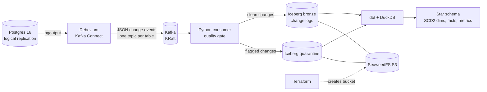

# Clinic bookings CDC lakehouse

Change data capture from a Postgres booking app into an Apache Iceberg lakehouse on S3-compatible storage, modelled into a star schema with dbt. Built to practise the streaming-CDC and open-table-format stack with the same engineering habits I use at work: tested Python, a non-blocking data quality layer, SCD Type 2 history and incremental loads.

All data is synthetic.



## What is in here

| Area | Where | What it shows |
|---|---|---|
| Postgres CDC with Debezium | `postgres/init.sql`, `connect/register-postgres.json` | logical replication, publication, `REPLICA IDENTITY FULL`, `ExtractNewRecordState` with delete rewrite and LSN metadata |
| Kafka | `docker-compose.yml`, `src/lakehouse/consumer.py` | single-node KRaft broker; consumer with manual offset commits after the Iceberg write (at-least-once) |
| Apache Iceberg | `src/lakehouse/sink.py`, `schemas.py` | PyIceberg with a SQL catalog, append-only change-log tables partitioned by `day(_source_ts)`, warehouse on S3 |
| Data quality | `src/lakehouse/quality.py` | rule classes with severity and owning team; errors held back, warnings loaded and flagged, nothing dropped silently |
| Terraform | `terraform/` | AWS provider pointed at a local S3 endpoint (or real AWS with one variable), a reusable storage module, versioning, tags |
| dbt | `dbt/` | dedupe of redelivered events, current state, SCD Type 2 from the change log, point-in-time fact joins, an incremental fact keyed on LSN, PII hashing/masking, generic and singular data tests, a dbt unit test |
| Testing and CI | `tests/`, `.github/workflows/ci.yml` | pytest (parsing, rules, Iceberg writes, consumer commit order with a fake Kafka client), ruff, and a full replay + `dbt build` in GitHub Actions without Docker |

## Run it

**Easiest: GitHub Codespaces.** On the repo page click **Code → Codespaces → Create codespace**. The dev container installs Python 3.12, Docker, Terraform and the project, so you can go straight to `make test`.

**Locally:** needs Python 3.11+, Docker, Terraform and `make`.

```bash
make install && source .venv/bin/activate
make test        # 15 Python tests
make offline     # no Docker: sample events -> Iceberg on local disk -> dbt build
```

The full pipeline:

```bash
make up          # Postgres, Kafka, Kafka Connect (Debezium), SeaweedFS
make infra       # Terraform creates the clinic-lakehouse-dev bucket
make register    # start the Debezium connector (snapshot, then streaming)
make simulate    # ~360 transactions of booking activity, ~6 bad rows
make consume     # Kafka -> Iceberg; stops after 20s with no new messages
make dbt         # build and test the star schema
make down        # stop and wipe everything
```

Look at the results:

```bash
python -c "import duckdb; c = duckdb.connect('.lakehouse/analytics.duckdb'); \
print(c.sql('select * from marts.mart_clinic_monthly order by 1, 3')); \
print(c.sql('select * from marts.mart_data_quality_issues'))"
```

Expected `dbt build` result: all tests pass with 2 warnings. Both warnings are intentional: payments whose appointment was held in quarantine (see "Bad data" below).

## Design decisions

**Bronze is an append-only change log, not a merged table.** Every snapshot read, insert, update and delete lands as its own row with `_op`, `_lsn` and `_source_ts`. Current state, SCD Type 2 history and "how often was this rescheduled?" are all derived from it in dbt. Merging on write would be cheaper to read but throws away history I cannot get back.

**At-least-once, with dedupe downstream.** Offsets are committed only after the Iceberg commit succeeds. A crash between the two replays the batch, so `stg_*_changes` keeps one row per `(key, _lsn, _op)`. The sample data includes five redelivered messages to prove it.

**Bad data does not stop the pipeline and is not dropped.** The quality gate gives each rule a severity and an owner. `error` changes are kept out of bronze and written to `bronze.quarantine` with the original payload, so they can be replayed after the source team fixes them; `warn` changes are loaded and also recorded. `mart_data_quality_issues` is the to-do list per team. A held-back parent shows up downstream as an orphan payment, which a dbt `relationships` test reports as a warning rather than failing the build.

**SCD Type 2 straight from CDC.** `scd2_from_changes` opens a new version only when a tracked column changes (an `updated_at`-only update does not create a version) and closes the open version on delete. The `scd2_valid` generic test checks there is at most one current version and no overlaps.

**Point-in-time joins.** `fct_appointments` joins the patient, practitioner and clinic versions that were valid when the booking was made, so a patient who later moves city keeps the city they had at booking time.

**Incremental by LSN.** `fct_payments` reads only changes with an LSN above the highest one already loaded and replaces those payments (`delete+insert`). Source deletes become `is_deleted = true` so an incremental run can apply them.

**PII.** Emails are hashed and phones masked in `dim_patient`; clear text stays in bronze only.

**Why SeaweedFS and not MinIO.** MinIO stopped publishing community Docker images in October 2025. SeaweedFS speaks the S3 API, and Terraform's AWS provider works against it unchanged.

## What I would change for production

- Use a shared Iceberg catalog (AWS Glue or a REST catalog) instead of the local SQLite one. In PyIceberg this is a configuration change, not a code change.
- Schedule compaction and snapshot expiry: frequent small appends create many small files.
- Run the consumer as a service with consumer-lag monitoring and alerting, and a dead-letter topic alongside the quarantine table.
- Compare against the Iceberg Kafka Connect sink. I wrote a consumer so the quality gate runs before data lands; the sink would remove custom code but move the checks downstream.
- Point the warehouse engine at the same Iceberg tables (Snowflake through a catalog integration, or Trino/Spark) instead of loading them into DuckDB on each run.
- Handle schema evolution explicitly (new source columns) using Iceberg's schema update API.
